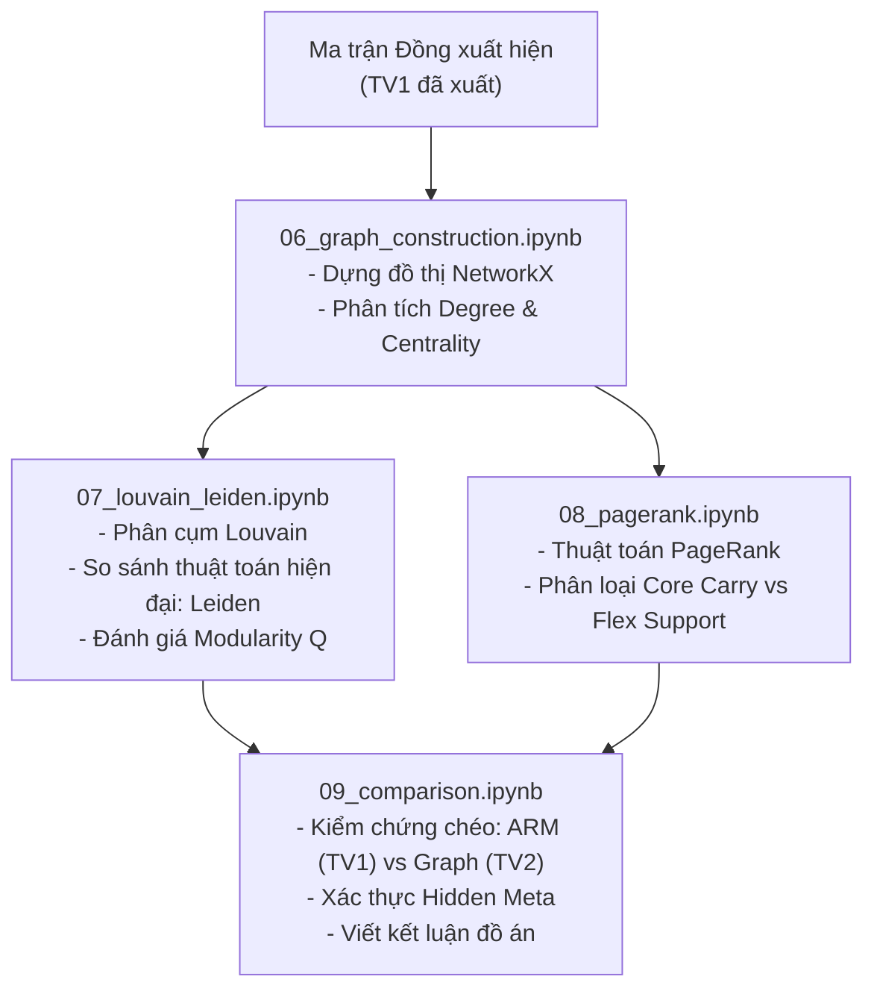

# 🧭 HƯỚNG DẪN & LỘ TRÌNH DÀNH CHO THÀNH VIÊN 2 (GRAPH MINING LEAD)

> **Dự án:** Khai phá Luật kết hợp & Biểu diễn Đồ thị trong Phân tích Meta-Game TFT  
> **Người bàn giao:** Thành viên 1 (Lead Dữ liệu & Association Rule Mining)  
> **Người tiếp nhận:** Thành viên 2 (Lead Khai phá Đồ thị & Tổng hợp)

---

## 1. Thành viên 1 đã hoàn thành và bàn giao những gì?
Thành viên 1 đã xây dựng hoàn thiện toàn bộ nền tảng dữ liệu và nhánh Khai phá Luật kết hợp (ARM):
1. **Dữ liệu thô (`data/raw/tft_matches.csv`)**: 5,000+ trận đấu ranked với đầy đủ Tướng, Trang bị, Tộc/Hệ, Thứ hạng (Top 1–8).
2. **Pipeline tiền xử lý (`src/preprocessor.py` & `notebooks/02_preprocessing.ipynb`)**:
   - Làm sạch dữ liệu, loại bỏ ngoại lệ/missing.
   - Gán nhãn `Win` (Top 1–4) và `Lose` (Top 5–8).
   - Xuất sẵn 2 ma trận đồng xuất hiện cho TV2:
     - `data/processed/cooc_frequency.pkl` (trọng số theo tần suất xuất hiện cùng nhau).
     - `data/processed/cooc_winrate.pkl` (trọng số theo tỷ lệ thắng khi đi cùng nhau).
3. **Thực nghiệm ARM (`notebooks/04_apriori.ipynb` & `05_fpgrowth.ipynb`)**:
   - Hoàn thành thuật toán Apriori và FP-Growth.
   - So sánh tốc độ và bộ nhớ (FP-Growth vượt trội gấp 5–15 lần).
   - Lọc các luật có $Lift > 1.5$ (chứng minh cộng hưởng thực sự).
   - Khai phá Contrast Set (Win vs Lose) và tìm ra các tổ hợp **Hidden Meta**.

---

## 2. Nhiệm vụ cụ thể tiếp theo của Thành viên 2

Thành viên 2 sẽ tiếp quản từ ma trận đồng xuất hiện (`cooc_winrate.pkl`) để triển khai toàn bộ nhánh **Graph Mining**:

### 📌 Nhiệm vụ 1: Xây dựng Đồ thị Mạng lưới (`notebooks/06_graph_construction.ipynb`)
- Nạp `data/processed/cooc_winrate.pkl`.
- Dùng thư viện `networkx` để tạo đồ thị vô hướng trọng số:
  - **Đỉnh (Node)**: Tướng TFT.
  - **Cạnh (Edge)**: Xuất hiện cùng nhau trong đội hình thắng.
  - **Trọng số (Weight)**: Tỷ lệ thắng (Win-rate) hoặc Tần suất.
- Lọc bỏ các cạnh yếu (`weight < threshold`).
- Tính toán các chỉ số mạng:
  - Phân phối bậc (Degree Distribution) – kiểm tra tính chất Scale-free / Power law.
  - Hệ số phân cụm trung bình (Average Clustering Coefficient).
  - Centrality metrics: Degree Centrality, Betweenness Centrality.
- Vẽ đồ thị mạng lưới liên kết tướng (Spring Layout / Matplotlib hoặc PyVis HTML tương tác).

---

### 📌 Nhiệm vụ 2: Phân cụm Đội hình Louvain & Leiden (`notebooks/07_louvain_leiden.ipynb`)
- **Thuật toán chính (Louvain)**:
  - Dùng `python-louvain` (`community.best_partition`).
  - Thử nghiệm các giá trị tham số `resolution` (0.5, 1.0, 1.5, 2.0).
  - Tính chỉ số **Modularity (Q)** để đánh giá chất lượng phân cụm.
- **Thuật toán hiện đại để so sánh (Leiden Algorithm)**:
  - Dùng thư viện `leidenalg` (hoặc `igraph`).
  - So sánh đối đầu với Louvain:
    - Giá trị Modularity (Leiden thường cao hơn hoặc bằng).
    - Khả năng đảm bảo các cụm liên thông (Leiden khắc phục nhược điểm cụm bị chia cắt của Louvain).
- **Định danh Meta Archetypes**:
  - Đặt tên cho từng cụm dựa vào các Tộc/Hệ thống trị (ví dụ: Cụm Zaun Gunner, Cụm Noxus Bruiser, Cụm Demacia Bastion).

---

### 📌 Nhiệm vụ 3: PageRank & Phân loại Vai trò Tướng (`notebooks/08_pagerank.ipynb`)
- Áp dụng thuật toán **PageRank** (`nx.pagerank`) với các hệ số tắt $\alpha = [0.5, 0.85, 0.95]$.
- Phân tích ý nghĩa trong Game:
  - Tướng có PageRank cao = Tướng nhận được nhiều "phiếu tín nhiệm" từ các tướng mạnh khác trong đội hình thắng $\rightarrow$ **Core Carry (Tướng gánh đội hạt nhân)**.
- Xây dựng ma trận 4 góc chiến thuật (PageRank vs Betweenness Centrality):
  - **PageRank cao + Betweenness thấp**: Core Carry chuyên biệt (Carry của 1 đội hình cụ thể).
  - **PageRank cao + Betweenness cao**: Tướng Flex quốc dân (vừa mạnh vừa ghép được vào nhiều bài).
  - **PageRank thấp + Degree cao**: Tướng kích hệ / Hỗ trợ (Support/Utility).

---

### 📌 Nhiệm vụ 4: Kiểm chứng chéo & Tổng hợp (`notebooks/09_comparison.ipynb`)
- Hai thành viên cùng ghép kết quả:
  - Đối chiếu: Các bộ tướng có $Lift > 1.5$ do TV1 tìm được có nằm cùng trong 1 cộng đồng (Community) do TV2 phát hiện không?
  - Xác thực **Hidden Meta**: Kết hợp luật ARM (tần suất thấp + lift cao) và đồ thị (cụm nhỏ có mật độ liên kết cao).
- Hoàn thiện bảng so sánh tổng hợp các phương pháp: Apriori vs FP-Growth vs Louvain vs Leiden vs PageRank.

---

## 3. Phần Báo cáo & Thuyết trình của Thành viên 2
- **Viết Báo cáo**:
  - Chương 2 (phần Cơ sở lý thuyết Khai phá Đồ thị: Co-occurrence Network, Modularity, Louvain, Leiden, PageRank).
  - Chương 4 (phần Thực nghiệm Đồ thị & Phân tích Cụm Đội hình).
  - Chương 5 (So sánh đối chiếu ARM vs Graph Mining).
  - Chương 6 (Hạn chế của đề tài & Hướng phát triển).
- **Thuyết trình**:
  - Trình bày phần Phương pháp Đồ thị (3 phút).
  - Kết quả Phân cụm Louvain/Leiden & PageRank (3 phút).
  - Đối chiếu kiểm chứng chéo & Kết luận chung (2 phút).
