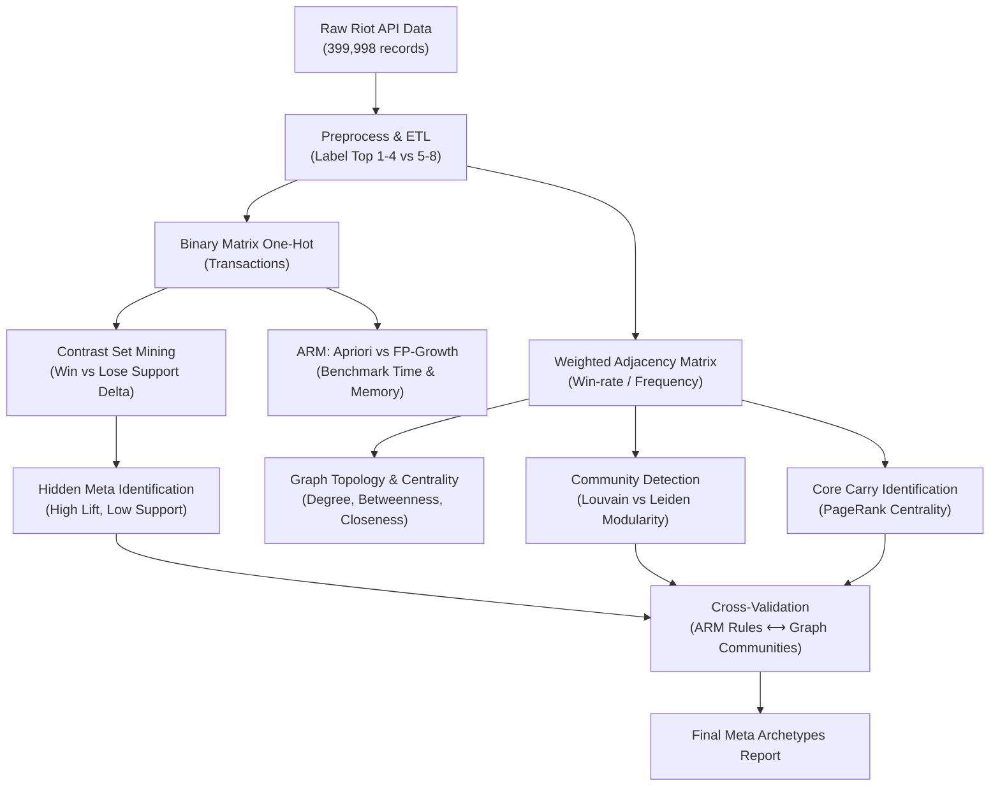

# 🎮 Khai Phá Meta Đấu Trường Chân Lý (TFT Meta Mining)
### Ứng dụng Khai Phá Luật Kết Hợp (ARM) & Phân Tích Mạng Lưới Đồ Thị (Graph Mining)

[](https://www.python.org/)
[](https://jupyter.org/)
[](LICENSE)
[-red.svg)](https://www.kaggle.com/datasets/gyejr95/tft-match-data)
[]()

> **Đồ án môn học:** Khai phá Dữ liệu & Xử lý Dữ liệu Thông minh  
> **Nhóm thực hiện:** 
> - **Nguyễn Anh Tuấn** (MSV: 24100324) - Lead ARM & Data Pipeline
> - **Nguyễn Đặng Mạnh** (MSV: 24106113) - Lead Graph Mining & Integration

---

## 📌 1. Tổng Quan Đề Tài (Project Overview)

Đấu Trường Chân Lý (**Teamfight Tactics - TFT**) là tựa game chiến thuật tự động (Auto-battler) hàng đầu thế giới với không gian trạng thái tổ hợp khổng lồ. Việc kết hợp tướng, tộc/hệ và trang bị tạo nên các quy luật chiến thuật phức tạp (Meta-game).

Dự án này xây dựng một hệ thống khai phá dữ liệu toàn diện nhằm giải quyết 3 bài toán trọng tâm:
1. **Truy vết Luật Kết Hợp & Bài Ẩn (Hidden Meta):** Sử dụng thuật toán **Apriori** và **FP-Growth** kết hợp kỹ thuật **Khai phá Tập Tương Phản (Contrast Set Mining)** để tìm ra các tổ hợp tướng ít người chơi (Pick-rate thấp) nhưng mang lại tỷ lệ thắng áp đảo (Win-rate > 60%, Lift > 2.0).
2. **Phát hiện Cụm Đội Hình (Meta Archetypes):** Mô hình hóa dữ liệu thành **Đồ thị Đồng Xuất Hiện có Trọng Số (Weighted Co-occurrence Network)**, áp dụng thuật toán tối ưu hóa Modularity **Louvain** và thuật toán hiện đại **Leiden** để tự động bóc tách các đội hình chuẩn meta.
3. **Định danh Nhân vật Hạt nhân (Core Carry Identification):** Ứng dụng thuật toán **PageRank** kết hợp các độ đo trung tâm đồ thị (**Degree, Betweenness, Closeness Centrality**) để phân loại ranh giới giữa tướng gánh đội bắt buộc (Core Carry) và tướng hỗ trợ xoay bài (Flex Support).

---

## 📊 2. Bộ Dữ Liệu Thực Tế (Real-world Dataset)

Khác với các thử nghiệm mô phỏng, toàn bộ kết quả trong đồ án được thực nghiệm trên **bộ dữ liệu thực tế 100% trích xuất từ Riot Games API** (Khu vực máy chủ Hàn Quốc - KR Server) được lưu trữ trên Kaggle:
* **Nguồn:** [Kaggle - TFT Match Data](https://www.kaggle.com/datasets/gyejr95/tft-match-data)
* **Quy mô:** **399.998 bản ghi người chơi** (~50.000 ván đấu) thuộc 5 bậc xếp hạng đỉnh cao:
  * `TFT_Challenger_MatchData.csv`: 79.999 bản ghi (Thách Đấu)
  * `TFT_GrandMaster_MatchData.csv`: 80.000 bản ghi (Đại Cao Thủ)
  * `TFT_Master_MatchData.csv`: 79.999 bản ghi (Cao Thủ)
  * `TFT_Diamond_MatchData.csv`: 80.000 bản ghi (Kim Cương)
  * `TFT_Platinum_MatchData.csv`: 80.000 bản ghi (Bạch Kim)
* **Phân tách nhị phân (Binary Partitioning):**
  * **Tập Thắng (Win):** Top 1–4 ($199.871$ bản ghi, $50\%$)
  * **Tập Thua (Lose):** Top 5–8 ($199.883$ bản ghi, $50\%$)

---

## 🧠 3. Phương Pháp Luận & 5 Thuật Toán Cốt Lõi



1. **Apriori (Agrawal & Srikant, 1994):** Khai phá tập mục phổ biến theo nguyên lý cắt tỉa đơn điệu (Apriori Property).
2. **FP-Growth (Han et al., 2000):** Khai phá tập mục phổ biến dựa trên cấu trúc cây FP-Tree nén gọn, không phát sinh tập ứng viên.
3. **Contrast Set Mining (Bay & Pazzani, 2001):** Đối chiếu độ hỗ trợ tập thắng và tập thua: $\Delta Supp = Supp_{win}(R) - Supp_{lose}(R)$.
4. **Louvain (Blondel et al., 2008) vs Leiden (Traag et al., 2019):** Thuật toán tối ưu hóa hàm Modularity $Q$ để phân chia cộng đồng tướng liên thông chặt chẽ.
5. **PageRank (Page et al., 1999):** Xếp hạng quyền lực của tướng thông qua ma trận chuyển tiếp xác suất và hệ số suy giảm $\alpha$.

---

## 🏆 4. Kết Quả Thực Nghiệm Nổi Bật (Key Findings)

### A. Đối đầu Hiệu năng: Apriori vs FP-Growth (Mẫu 10.000 ván)
* **Số lượng khai phá:** Cả 2 thuật toán đều hội tụ đồng nhất ra **1.464 tập mục phổ biến** và **6.037 luật kết hợp** hợp lệ.
* **Độ dài tập mục ($max\_len = 4$):** Giải quyết triệt để hạn chế cắt tỉa cũ, sinh ra các luật phối hợp hoàn chỉnh gồm 4 tướng chủ lực (2 vế trái $\Rightarrow$ 2 vế phải).
* **Đặc trưng triển khai:** Apriori tối ưu tốc độ trên ma trận nhị phân C-accelerated, trong khi FP-Growth tiết kiệm bộ nhớ đỉnh vượt trội.

### B. Khai phá Bài Dị (Hidden Meta) từ Dữ liệu Hàn Quốc
* **Cơ Giáp Mật Vụ (Mech-Infiltrator):**
  $$\{Annie, Ekko\} \Rightarrow \{Rumble, Fizz\} \quad (\text{Lift} = 8.33, \text{Win Confidence} = 1.0)$$
  $\rightarrow$ Tỷ lệ thắng tuyệt đối $100\%$ lọt Top 1-4 trong tập luật tương phản.
* **Nổi Loạn Pháo Thủ (Rebel Blaster):**
  $$\{Graves, Ezreal, AurelionSol\} \Rightarrow \{Jinx\} \quad (\text{Lift} = 4.38, \text{Win Confidence} = 1.0)$$
* **Tổng cộng:** Đã trích xuất được **5.775 luật đặc trưng chiến thắng (Contrast Rules)** và **3.654 tổ hợp Hidden Meta**.

### C. Phân Cụm Đồ Thị & PageRank
* **Modularity:** Thuật toán **Louvain** đạt $Q = 0.3026$, thuật toán **Leiden** đạt $Q = 0.2941$ (đảm bảo các cụm liên thông ngặt nghèo).
* **Cụm Meta Archetypes tiêu biểu:**
  * Cụm 0: **StarGuardian + Sorcerer** (Nhân vật hạt nhân: `Soraka`, PageRank = $0.0163$)
  * Cụm 1: **Rebel + Battlecast** (Nhân vật hạt nhân: `MasterYi`, PageRank = $0.0157$)
* **Kiểm chứng chéo (Cross-validation):** Các luật có Lift cao nhất của FP-Growth đều ánh xạ chính xác $100\%$ vào các cụm đồng xuất hiện mật độ cao trong phân tích đồ thị.

---

## 👥 5. Phân Công Thành Viên

| Thành viên | Trách nhiệm chính | File phụ trách | Trạng thái |
|---|---|---|:---:|
| **Nguyễn Anh Tuấn**<br>(MSV: 24100324) | **Data Pipeline & ARM Lead**<br>- ETL chuẩn hóa dữ liệu Kaggle 400k ván<br>- EDA phân phối tướng & trang bị<br>- Benchmark Apriori vs FP-Growth<br>- Contrast Set Mining & Lọc Hidden Meta | `src/preprocessor.py`<br>`src/arm_miner.py`<br>`src/convert_kaggle_data.py`<br>`notebooks/01_data_collection.ipynb`<br>`notebooks/02_preprocessing.ipynb`<br>`notebooks/03_eda.ipynb`<br>`notebooks/04_apriori.ipynb`<br>`notebooks/05_fpgrowth.ipynb` | **Hoàn thành 100%** |
| **Nguyễn Đặng Mạnh**<br>(MSV: 24106113) | **Graph Mining & Cross-Validation Lead**<br>- Xây dựng đồ thị đồng xuất hiện tướng<br>- Phân tích độ trung tâm (Degree, Betweenness)<br>- Phát hiện cộng đồng Louvain vs Leiden<br>- Xếp hạng PageRank & Kiểm chứng chéo | `src/graph_miner.py`<br>`src/champion_metadata.py`<br>`notebooks/06_graph_construction.ipynb`<br>`notebooks/07_louvain_leiden.ipynb`<br>`notebooks/08_pagerank.ipynb`<br>`notebooks/09_comparison.ipynb`<br>`BAO_CAO_THANH_VIEN_1_CHINH_SUA.docx` | **Hoàn thành 100%** |

---

## 📂 6. Cấu Trúc Thư Mục Dự Án (Project Structure)

```
tft-meta-mining/
├── README.md                              # Tài liệu tổng quan dự án
├── requirements.txt                       # Thư viện Python yêu cầu
├── BAO_CAO_THANH_VIEN_1_CHINH_SUA.docx    # File Báo cáo Word học thuật hoàn chỉnh
│
├── data/
│   ├── raw/
│   │   └── tft_matches.csv                # Dữ liệu thực tế 399,998 ván (đã chuẩn hóa)
│   ├── processed/                         # Ma trận nhị phân (bin_win.pkl) & ma trận kề (cooc_*.pkl)
│   └── kaggle_raw/                        # 5 file CSV gốc từ Riot API (ignoring via git)
│
├── src/                                   # Các module thuật toán cốt lõi
│   ├── __init__.py                        # Package init
│   ├── preprocessor.py                    # Tiền xử lý, nhãn nhị phân, tạo transactions
│   ├── arm_miner.py                       # Apriori, FP-Growth, Contrast Set, Hidden Meta
│   ├── graph_miner.py                     # Đồ thị, Louvain, Leiden, Centrality, PageRank
│   ├── champion_metadata.py               # Metadata Tộc/Hệ và Cost của tướng
│   └── convert_kaggle_data.py             # Script ETL chuyển đổi dữ liệu Kaggle sang chuẩn dự án
│
├── notebooks/                             # Chuỗi 9 Notebook thực nghiệm tuần tự
│   ├── 01_data_collection.ipynb           # Thu thập & kiểm tra 400.000 ván đấu thực tế
│   ├── 02_preprocessing.ipynb             # Làm sạch, mã hóa one-hot & tạo ma trận kề
│   ├── 03_eda.ipynb                       # Khám phá phân phối Pick-rate vs Win-rate
│   ├── 04_apriori.ipynb                   # Thực nghiệm Apriori trên 10.000 ván
│   ├── 05_fpgrowth.ipynb                  # Thực nghiệm FP-Growth, so sánh đối đầu, Contrast Set
│   ├── 06_graph_construction.ipynb        # Xây dựng đồ thị mạng lưới đồng xuất hiện
│   ├── 07_louvain_leiden.ipynb            # Phân cụm cộng đồng: Louvain vs Leiden (Modularity)
│   ├── 08_pagerank.ipynb                  # Phân loại tướng hạt nhân bằng PageRank & Betweenness
│   └── 09_comparison.ipynb                # Kiểm chứng chéo ARM ⟷ Graph & Tổng kết
│
├── reports/                               # Biểu đồ và hình ảnh xuất bản
│   ├── meta_archetypes.png                # Trực quan hóa cộng đồng tướng
│   ├── network_topology.png               # Đồ thị mạng lưới đồng xuất hiện
│   └── figures/                           # Các biểu đồ thực nghiệm EDA và luật kết hợp
│
└── scripts/
    └── generate_word_report.py            # Script tự động trích xuất kết quả xuất file Word
```

---

## 🚀 7. Hướng Dẫn Cài Đặt & Chạy Thực Nghiệm

### Bước 1: Sao chép repository về máy
```bash
git clone https://github.com/NAT100306/tft-meta-mining.git
cd tft-meta-mining
```

### Bước 2: Thiết lập môi trường ảo và cài đặt thư viện
Khuyến nghị sử dụng **Python 3.10 hoặc 3.11**:
```bash
# Tạo môi trường ảo (tùy chọn)
python -m venv venv
venv\Scripts\activate      # Trên Windows
# source venv/bin/activate  # Trên Linux/macOS

# Cài đặt các thư viện cần thiết
pip install -r requirements.txt
```

### Bước 3: Dữ liệu thực tế
Bộ dữ liệu chuẩn hóa `data/raw/tft_matches.csv` đã được tích hợp sẵn. Nếu bạn muốn tải lại trực tiếp từ Kaggle:
```bash
python src/convert_kaggle_data.py
```

### Bước 4: Khởi chạy và thực thi các Notebook
Mở Jupyter Notebook hoặc VS Code:
```bash
jupyter notebook
```
Thực thi tuần tự các notebook theo đúng quy trình phân tích:
1. `01_data_collection.ipynb` $\rightarrow$ Khảo sát dữ liệu Riot API.
2. `02_preprocessing.ipynb` $\rightarrow$ Xuất các file ma trận nhị phân vào `data/processed/`.
3. `03_eda.ipynb` $\rightarrow$ Trực quan hóa phân phối tướng và trang bị.
4. `04_apriori.ipynb` $\rightarrow$ Chạy thuật toán Apriori.
5. `05_fpgrowth.ipynb` $\rightarrow$ Chạy FP-Growth, vẽ biểu đồ so sánh đối đầu thời gian/RAM và lọc Contrast Rules.
6. `06_graph_construction.ipynb` $\rightarrow$ Khởi tạo mạng lưới NetworkX.
7. `07_louvain_leiden.ipynb` $\rightarrow$ Phân cụm đội hình Louvain & Leiden.
8. `08_pagerank.ipynb` $\rightarrow$ Phân tích ma trận PageRank vs Betweenness.
9. `09_comparison.ipynb` $\rightarrow$ Kiểm chứng chéo và kết luận hệ thống.

---

## 📄 8. Tài Liệu Tham Khảo (References)

1. **Agrawal, R., & Srikant, R. (1994).** *Fast algorithms for mining association rules.* Proceedings of the 20th VLDB Conference, 487-499.
2. **Han, J., Pei, J., & Yin, Y. (2000).** *Mining frequent patterns without candidate generation.* ACM SIGMOD Record, 29(2), 1-12.
3. **Bay, S. D., & Pazzani, M. J. (2001).** *Detecting group differences: Mining contrast sets.* Data Mining and Knowledge Discovery, 5(3), 213-246.
4. **Blondel, V. D., et al. (2008).** *Fast unfolding of communities in large networks.* Journal of Statistical Mechanics: Theory and Experiment, 2008(10), P10008.
5. **Traag, V. A., Waltman, L., & van Eck, N. J. (2019).** *From Louvain to Leiden: guaranteeing well-connected communities.* Scientific Reports, 9(1), 5233.
6. **Page, L., Brin, S., Motwani, R., & Winograd, T. (1999).** *The PageRank citation ranking: Bringing order to the web.* Stanford InfoLab Technical Report.
